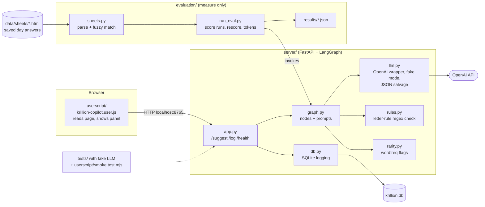
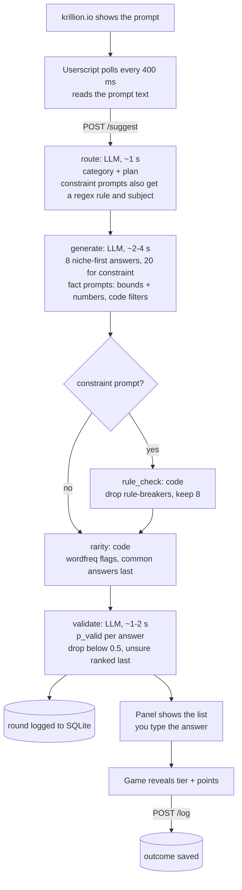
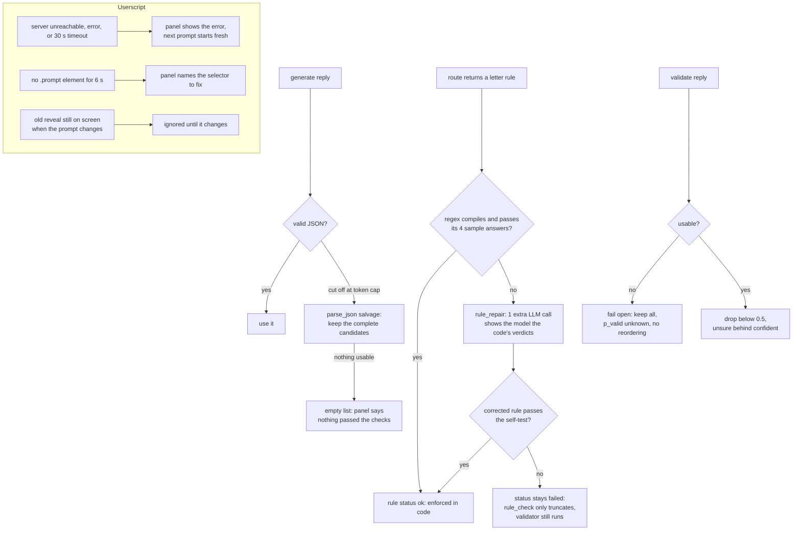

# Krillion copilot

A Tampermonkey userscript reads the current Krillion prompt and shows AI-suggested rare answers in a side panel.
**You type every answer yourself.** The script only reads the page; it never types, clicks or submits an answer.

Pipeline (LangGraph): `route -> generate -> rule_check -> rarity -> validate`, logging every round to SQLite.
See CLAUDE.md for what each node does and the evaluation tooling.

## Setup
```bash
python -m venv .venv && source .venv/bin/activate      # Windows: .venv\Scripts\activate
pip install -r requirements.txt
cp .env.example .env                                   # then put your OpenAI key in .env
python -m pytest -q                                    # runs with a fake LLM, no key needed
uvicorn server.app:app --port 8765
```
Then in Chrome: install the Tampermonkey extension, create a new script, paste `userscript/krillion-copilot.user.js`,
save, and open krillion.io. If the script doesn't run, check that Tampermonkey is enabled for the site.
If the panel says it can't find the prompt, the site markup changed: fix `SEL` at the top of the userscript.
The panel shows each answer with a short reason; "~N% sure" appears only when the validator was unsure, and
"Dropped" (collapsed) lists answers the checks removed. Click the panel title to collapse it.
Offline test of the userscript logic (fake DOM, no browser): `node userscript/smoke.test.mjs`.

## Try the server without the browser
```bash
curl -s localhost:8765/suggest -H 'content-type: application/json' -d '{"prompt":"Name a pasta shape"}'
```
The response includes `total_ms` and per-node `calls` with latencies: this is the first latency measurement.

## Layout
- `server/llm.py` OpenAI wrapper (model from `KRILLION_MODEL`, default `gpt-4.1-mini`), fake mode for tests
- `server/graph.py` LangGraph nodes and prompts
- `server/db.py` SQLite logging (`krillion.db`, git-ignored)
- `server/app.py` `/suggest`, `/log`, `/health`
- `userscript/krillion-copilot.user.js` page reader and panel (selectors in one `SEL` block)








